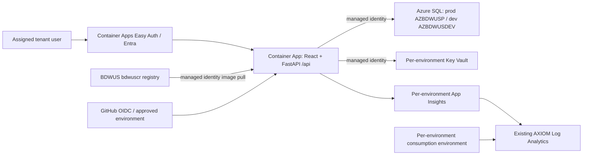

# BDWUS — Northstar Telecom Portal

BDWUS is a telecom operations portal for customer accounts, product and rate-plan pricing, sales quotes/opportunities, billing, care and service operations. React 19 + Vite provides the UI; FastAPI provides pricing and SQL-backed workflows. Azure SQL remains the system of record.

**Dev and production are deployed** behind tenant-restricted Entra sign-in on Azure Container Apps. The owner confirmed initial sign-in worked. The approved October security follow-up is deployed to both environments, and each has the four explicitly approved billing demo facts. See [current live checks](docs/live-state-review.md), [SQL review](docs/database-review.md) and [data sources](docs/data-source-status.md).

## Repository

| Path | Purpose |
| --- | --- |
| web-ui | React portal and Playwright tests |
| pricing-microservice | FastAPI, pricing calculations, managed-identity SQL connection, versioned SQL and mocked tests |
| infra | Bicep foundations, portal, SQL references and access assignments |
| azure.yaml | azd portal service and Bicep configuration |
| scripts/local_checks.py | Local checks, no cloud calls |
| docs | Owner approval instructions, inventory and migration status |

billing-demo, its CSV outputs and the stray Test file are already absent in the current checkout. There is no mockData.js in this revision.

## Proposed architecture



A single app keeps UI/API cookies and requests on one origin, avoids CORS and reduces deployment and authentication configuration. Both scale together, so CPU-heavy API work could affect UI latency; separate apps become useful when load requires independent scaling. Data API builder is not added: the existing FastAPI API already handles reads and business operations. A second app would add authentication, routing and deployment work without removing the custom pricing API. The assistant is off by default until its AI permissions and costs are approved.

## Run locally

Use Python 3.11+, Node 22+, Microsoft ODBC Driver 18 and its unixODBC dependency. SQL is optional for mocked tests. Live SQL requires Azure CLI sign-in, Entra database permission and an already-approved network route.

```sh
python3 -m venv .venv
source .venv/bin/activate
pip install -r pricing-microservice/requirements-dev.txt
npm --prefix web-ui ci
# Demo role selection is explicitly local only. Do not use this on Azure.
export PLATFORM_AUTH_MODE=local
export AI_ASSISTANT_OFFLINE=true
export SQL_SERVER=bdwus.database.windows.net
export SQL_DATABASE=AZBDWUSDEV
cd pricing-microservice
uvicorn app.main:app --host 127.0.0.1 --port 8000
```

In another terminal run `npm --prefix web-ui run dev`. Vite proxies `/api` to localhost:8000. No password-based SQL authentication exists. To build the combined image locally, run `docker build --platform linux/amd64 -t bdwus-portal:review .`. API health is `/health`; readiness is `/health/ready` and requires SQL unless explicit local smoke mode is enabled.

## Dev and prod

Separate azd environments named **dev** and **prod** select distinct resource groups, Container Apps environments/apps, managed identities, vaults, Insights and budgets. Dev declares a new AZBDWUSDEV on the existing bdwus server, free offer with AutoPause at the free limit. Prod references existing AZBDWUSP; it is already free serverless with AutoPause. The server is existing and its authentication/firewall configuration is not modified. Sharing the logical SQL server means server-level administration/network policy is common; database roles and data are separate.

Default monthly budgets are $10 dev and $25 prod, with actual 80%/100% and forecast 100% email alerts. Set Bicep devBudgetAmount/prodBudgetAmount parameters to change amounts. Budgets are alerts, not spending limits, and resource-group budgets do not include the shared workspace/registry or dev SQL in the existing SQL resource group. Review total subscription cost as well.

## Settings and secrets

[.env.example](.env.example) lists nonsecret settings with empty values. It is an inventory, not a ready-to-source environment. Set only needed values; blank numeric overrides cause validation errors. Never place secrets in .env or azd files. All VITE_ values are public build settings; use their same-origin defaults in deployment.

Per-environment vault names come from azd output AZURE_KEY_VAULT_NAME. Store **entra-client-secret** in each environment vault; Container Apps references it through managed identity. **github-token** is optional, for assistant repository operations, and is read directly from that vault by managed identity. No SQL password, storage key, registry password or AI API key is required. Do not copy AXIOM broker secrets. Configure/rotate secrets using the Azure portal after approval. Runtime managed identities need repository-scoped Container Registry Repository Reader on bdwuscr and Key Vault Secrets User; reviewed SQL roles grant data access without DDL rights. Optional Azure AI access uses managed identity and needs a separately approved role/deployment.

## Deployment reference — initial rollout completed

[Entra/GitHub setup](docs/entra-owner-steps.md) describes single-tenant registrations, user assignment, callback URIs, role claims, secret names and OIDC trust. Owner-approved dev/prod registrations, owner Admin assignments and vault credentials are configured. Production already requires the owner as reviewer, and BDWUS_DEPLOY_APPROVED=true is already set. Changes to that policy or future deployments require the applicable owner approval.

The initial rollout and its settings are complete. The commands below are recreation/maintenance reference, not outstanding setup. Re-run only for a specifically approved change, in the intended environment (example dev; repeat deliberately for prod):

```sh
azd env new dev --subscription a8f3fd5d-0d2f-4715-b685-728b21d1cc10 --location eastus
azd env set SHARED_REGISTRY_RESOURCE_ID /subscriptions/a8f3fd5d-0d2f-4715-b685-728b21d1cc10/resourceGroups/AZURE-SQL-PNG/providers/Microsoft.ContainerRegistry/registries/bdwuscr
azd env set REGISTRY_ROLE_ASSIGNMENT_MODE AbacRepositoryPermissions
azd env set SHARED_WORKSPACE_RESOURCE_ID /subscriptions/a8f3fd5d-0d2f-4715-b685-728b21d1cc10/resourceGroups/rg-financial-advisor-8a42/providers/Microsoft.OperationalInsights/workspaces/log-financial-advisor-8a42-vuti2u
azd env set SQL_SERVER_RESOURCE_ID /subscriptions/a8f3fd5d-0d2f-4715-b685-728b21d1cc10/resourceGroups/AZURE-SQL-PNG/providers/Microsoft.Sql/servers/bdwus
azd env set ENTRA_TENANT_ID 4e1db426-c797-4336-bd16-7e771a5de494
azd env set ENTRA_CLIENT_ID <that-environment-registration-client-id>
azd env set BUDGET_EMAIL <owner-alert-email>
azd env set BUDGET_START_DATE <first-day-of-current-month-YYYY-MM-DD>
azd env set BUDGET_END_DATE <future-first-day-YYYY-MM-DD>
azd env set SERVICE_PORTAL_IMAGE_NAME bdwuscr.azurecr.io/bdwus-portal:<reviewed-commit-sha>
azd env set DEPLOY_PORTAL false
azd env set PORTAL_PUBLIC_INGRESS false
# Review locally; this does not call Azure provisioning.
az bicep build --file infra/main.bicep --outfile /tmp/bdwus-infra.json
# MUTATION: owner approval required before this command.
azd provision
```

Foundations create the dev database, identity, vault, consumption environment, Insights and budget. Before the second provisioning: populate entra-client-secret, configure assignment-required Entra sign-in, review and apply dev SQL, review and execute grant_portal_access.sql in each database as the Entra SQL administrator, and publish the reviewed image. Do not grant db_owner/db_ddladmin to runtime identities. Do not apply dev schema files to prod.

After the required setup and approval, local image publishing additionally needs an authorized Repository Writer assignment for bdwus-portal; Owner alone grants no repository data access in ABAC mode. Existing releases normally use the GitHub OIDC workflow, whose identities already have that assignment.

Update and verify the separate GitHub variables for BOTH dev and prod during registry cutover (repeat with `--env prod`):

```sh
gh variable set ACR_NAME --repo BrianDWalker/BDWUS --env dev --body bdwuscr
gh variable set ACR_LOGIN_SERVER --repo BrianDWalker/BDWUS --env dev --body bdwuscr.azurecr.io
gh variable list --repo BrianDWalker/BDWUS --env dev
```

Both environments were updated and their OIDC deployments verified during the approved follow-up. For an authorized local publishing identity:

```sh
az acr login --name bdwuscr
docker build --platform linux/amd64 -t bdwuscr.azurecr.io/bdwus-portal:<reviewed-commit-sha> .
docker push bdwuscr.azurecr.io/bdwus-portal:<reviewed-commit-sha>
azd env set DEPLOY_PORTAL true
# First app creation is private while Easy Auth is installed.
azd provision
# Verify authConfigs/current platform.enabled and the tenant registration.
azd env set PORTAL_PUBLIC_INGRESS true
azd provision
azd deploy portal
```

The last command is optional after the second provision already starts the exact reviewed image; use azd deploy for subsequent local approved releases. Provisioning must use a real built image, not a placeholder. First validate unauthenticated redirects, assigned-user sign-in, cross-tenant denial, role-denied mutations, SQL reads and vault/registry access in dev. Update callback URI to the app's computed host before testing. Cut over prod only after approval. The old Static Web App is deleted. bdwuscr is retained as the BDWUS registry; the old Container App, environment and workspace remain. AXIOM registry settings are unchanged.

After resources are approved and provisioned, the single GitHub deploy workflow builds once, pushes through OIDC and updates the existing app. Main pushes deploy dev; prod only via workflow_dispatch with environment prod and GitHub owner approval. It never provisions, migrates SQL, or reads credentials from static workflow secrets. Local checks replace the old CI test/browser/deployed-smoke jobs to reduce Actions minutes.

## Local checks

Install gitleaks locally (for example `brew install gitleaks`) and activate .venv first:

```sh
pre-commit install
pre-commit run --all-files
python scripts/local_checks.py pytest
npm --prefix web-ui run lint
npm --prefix web-ui run build
```

Hooks run Ruff, ESLint, redacted gitleaks, Vite production build and pytest. Tests mock SQL and forbid acquiring Azure credentials or real connections. Monthly grouped Dependabot covers npm, pip, Actions and Docker.

## Costs and deployment status

See [read-only inventory and cost report](docs/azure-owner-review.md). September observed BDWUS cost was about $5, mostly its separate registry; SQL was $0. Low-traffic incremental planning ranges are $0–10/month dev and $0–25/month prod, excluding shared AXIOM baseline costs, retained old resources, optional AI and egress. Container Apps free grants are subscription-wide and shared with AXIOM; logging is metered. These estimates are not billing caps.

Owner approval received and executed on 12–13 October 2026: dev/prod resources, production catalog reconciliation, dev schema/seed, additive billing SQL, runtime grants, assignment-required Entra apps, owner Admin assignments, Key Vault credentials and GitHub OIDC environments are configured. Both portals are live behind Easy Auth. The repository deployment approval flag is enabled. The owner confirmed initial Microsoft sign-in succeeded. Never use azd down to clean up the existing production data or shared AXIOM resources.

Live portals: [dev](https://ca-bdwus-dev.politesmoke-b8649377.eastus.azurecontainerapps.io) · [production](https://ca-bdwus-prod.happytree-d3cda5bf.eastus.azurecontainerapps.io). See [.azure/deployment-plan.md](.azure/deployment-plan.md) for validation evidence and workflow results.


The approved security follow-up is deployed to dev and production. See [owner checklist](docs/owner-checklist.md) and [current live verification](docs/live-state-review.md) for deployment, data and retirement results. `ms.vPricingContext` is synthetic; the billing facts pages read the SQL views and now show the explicitly approved demo records.
